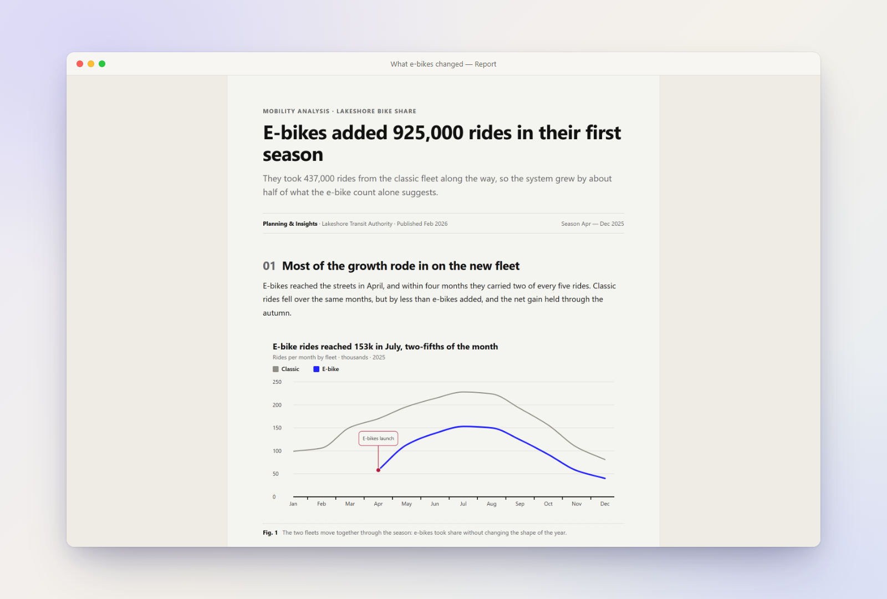
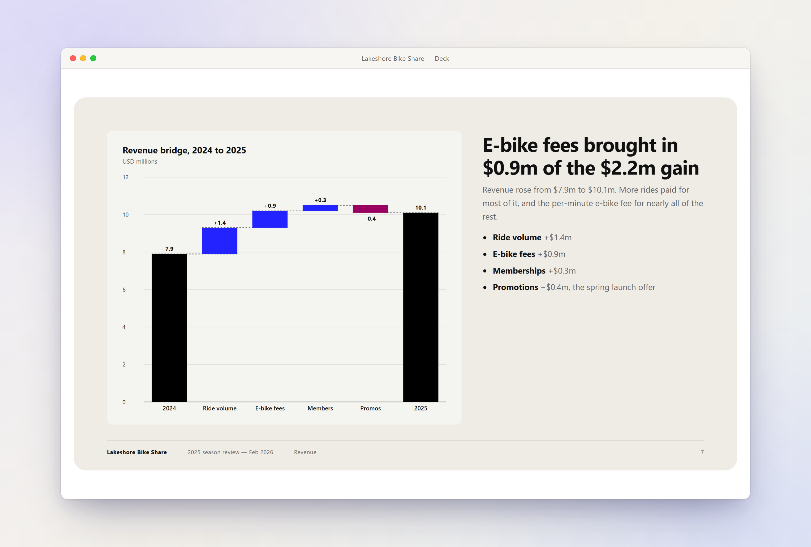
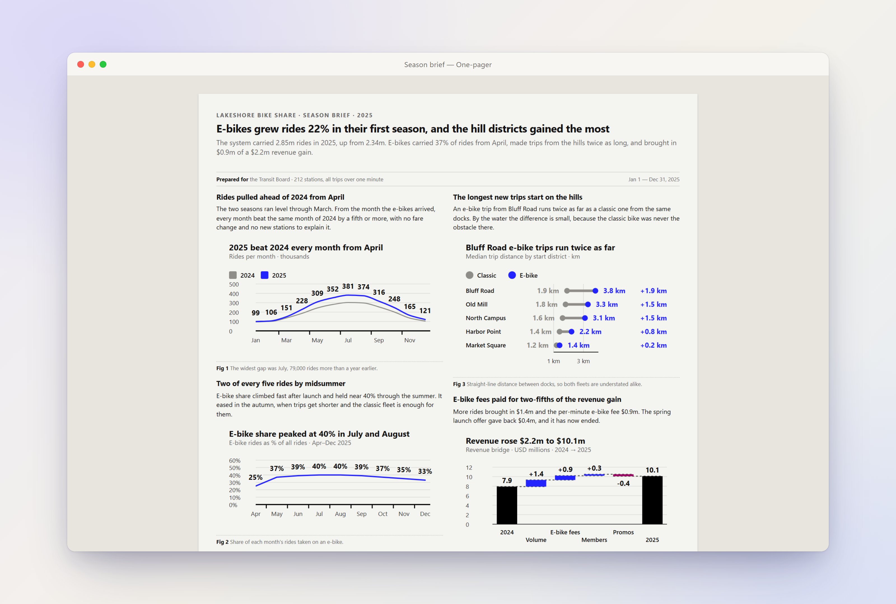

# raghuram-skills — Claude Skills for Dashboards, Decks, Videos and Everyday Corporate Work

[](LICENSE)
[](https://docs.claude.com/en/docs/agents-and-tools/agent-skills/overview)
[](https://docs.claude.com/en/docs/claude-code/plugins)
[](#what-are-the-dependencies)
[](#does-it-work-offline)

**raghuram-skills is a free, open-source marketplace of eleven independent Claude Agent
Skills for the work that fills a corporate week.** Five of them *make* something from
your data — a dashboard, report, slide deck, one-pager, email or Teams snapshot, social
post, explainer video, diorama video or documentary film. Six of them *read* what you already have —
a meeting transcript, an email thread, two periods of a reporting pack, a spreadsheet,
a deck — and hand back only the part that matters.

Every skill installs on its own, works in **Claude Code**, **claude.ai**, **Claude
Desktop** and the **Claude API**, and is plain Markdown (plus, for the five that make
things, a dependency-free JavaScript library), so it also runs in **Gemini CLI**,
**OpenAI Codex**, **GitHub Copilot**, **Cursor** and any other agent that can read a file.

📖 **[Full documentation and FAQ →](https://raghuramsirigiri.github.io/raghuram-skills/)**


<sub>A dashboard, an email snapshot and a slide deck, built by `chart-dashboard` from the same data. Each format is shown on its own under [Output formats](#output-formats).</sub>

---

## Contents

- [The skills at a glance](#the-skills-at-a-glance)
- [Installation](#installation)
- [Skills that make things](#skills-that-make-things)
  - [chart-dashboard](#chart-dashboard) · [social-post](#social-post) · [explainer-video](#explainer-video) · [diorama-slides](#diorama-slides) · [documentary-video](#documentary-video)
- [Skills that read and condense](#skills-that-read-and-condense)
  - [decisions-only](#decisions-only) · [exec-brief](#exec-brief) · [whats-changed](#whats-changed)
- [Skills that check before you send](#skills-that-check-before-you-send)
  - [sanity-check](#sanity-check) · [chart-honesty](#chart-honesty) · [action-titles](#action-titles)
- [What every skill shares](#what-every-skill-shares)
- [chart-dashboard in depth](#chart-dashboard-in-depth)
  - [Output formats](#output-formats) · [Chart types](#which-chart-types-are-supported) · [Theming](#theming-and-brand-colors) · [FAQ](#chart-dashboard-faq)
- [FAQ](#faq)
- [Repository layout](#repository-layout)
- [Known limitations](#known-limitations)
- [Contributing](#contributing)
- [License](#license)

---

## The skills at a glance

| Skill | You give it | You get back | Version |
|:--|:--|:--|:--|
| **Make** | | | |
| [`chart-dashboard`](#chart-dashboard) | A table, CSV, pasted numbers, metrics or notes | One self-contained HTML dashboard, report, slide deck, printable one-pager, email snapshot, Teams post or social post, with interactive SVG charts | 1.14.0 |
| [`social-post`](#social-post) | Data and the platforms you post on | One to three chart cards painted at each platform's picture size, plus the words to post for LinkedIn, X, Bluesky, Threads, Mastodon or Instagram | 1.0.0 |
| [`explainer-video`](#explainer-video) | An article, news story, report findings or a table | A 15–60 s motion-graphics explainer with flat charts, exported as MP4 in your browser | 1.1.0 |
| [`diorama-slides`](#diorama-slides) | An article, history, report or table where something visibly happens | A 15–60 s video: a still card of words over a living 2.5D toy-diorama world that acts out each insight, exported as MP4 | 0.1.0 |
| [`documentary-video`](#documentary-video) | Any document — a sales summary, a history chapter, a science article | A documentary-style short film with a screenplay, cast and places designed from the document, in a toy-diorama 3D world, exported as MP4 | 1.0.0 |
| **Read** | | | |
| [`decisions-only`](#decisions-only) | A meeting transcript, recap or notes | The decisions and commitments — what was chosen, who owns what, by when — and nothing else | 1.2.0 |
| [`exec-brief`](#exec-brief) | A long email thread, chat, status report or document | One bottom-line sentence, at most three points and one ask, ready to paste upward | 1.0.0 |
| [`whats-changed`](#whats-changed) | This period's and last period's numbers (workbook, CSV, deck, PDF, Word) | What moved, by how much, and the two or three lines that explain the total | 1.2.0 |
| **Check** | | | |
| [`sanity-check`](#sanity-check) | One spreadsheet, deck, PDF or document | The mistakes that would embarrass you, ranked into what blocks sending and what merely invites a question | 1.0.0 |
| [`chart-honesty`](#chart-honesty) | A PowerPoint deck, or charts described in chat | Every chart that misleads — truncated or dual axis, 3D, pie misuse, a title the data contradicts — with the fix for each | 1.0.0 |
| [`action-titles`](#action-titles) | A PowerPoint deck or pasted slides | Each slide's title rewritten as the claim the slide proves, and every current title that claims more than its slide shows | 1.0.0 |

Each one triggers on its own when you ask in plain language — no slash command needed.

## Installation

### Claude Code — plugin install (recommended)

Add the marketplace once:

```bash
/plugin marketplace add raghuramsirigiri/raghuram-skills
```

Then install whichever skills you want. Installing one never pulls in the others:

```bash
/plugin install chart-dashboard@raghuram-skills
```

```bash
/plugin install decisions-only@raghuram-skills
```

The same pattern works for every skill: `/plugin install <name>@raghuram-skills`, where
`<name>` is any of `chart-dashboard`, `social-post`, `explainer-video`,
`diorama-slides`, `documentary-video`, `decisions-only`, `exec-brief`, `whats-changed`, `sanity-check`,
`chart-honesty` or `action-titles`.

### Claude Code — manual install

```bash
git clone https://github.com/raghuramsirigiri/raghuram-skills.git
```

Copy any skill folder into your skills directory — for example:

```bash
cp -r raghuram-skills/plugins/exec-brief/skills/exec-brief ~/.claude/skills/
```

Every skill lives at `plugins/<name>/skills/<name>/`. To scope a skill to one project
instead of every project, copy it into `.claude/skills/` in that project's root.

### claude.ai, Claude Desktop, and the API

Zip a skill folder, then upload it under **Settings → Capabilities → Skills**:

```bash
cd raghuram-skills/plugins/chart-dashboard/skills && zip -r chart-dashboard.zip chart-dashboard
```

Swap `chart-dashboard` for any other skill's name to package that one.

### Gemini CLI, OpenAI Codex, GitHub Copilot, Cursor, and other AI tools

Nothing in any skill is Claude-specific. Any agent that can read files can run the
read-and-check skills; the five that make things also need to write an HTML file and,
for the final checks, run Node.

**1. Copy the skill into your project:**

```bash
cp -r raghuram-skills/plugins/chart-dashboard/skills/chart-dashboard ./.agent-skills/chart-dashboard
```

**2. Point your tool at it** by adding a block like this to whichever instruction file
your tool reads, one line per skill you copied:

```markdown
## Skills
- Dashboards, reports, decks, one-pagers, email/Teams/social charts:
  follow `.agent-skills/chart-dashboard/SKILL.md`.
- Decisions and commitments from a meeting transcript:
  follow `.agent-skills/decisions-only/SKILL.md`.
```

| Tool | Where to put that block |
|:--|:--|
| OpenAI Codex, Cursor, Zed, Aider, Jules, opencode | `AGENTS.md` in the repo root |
| Gemini CLI, Gemini Code Assist | `GEMINI.md` in the repo root |
| GitHub Copilot (VS Code, JetBrains, CLI) | `.github/copilot-instructions.md` |
| Windsurf | `.windsurf/rules/<skill>.md` |
| Cline / Roo Code | `.clinerules/<skill>.md` |
| Claude Code, Claude Desktop, claude.ai | Install as a skill (above), or `CLAUDE.md` |
| Anything else | Paste the skill's `SKILL.md` into your system prompt |

Copyable starting points in this repo: [`AGENTS.md`](AGENTS.md),
[`GEMINI.md`](GEMINI.md) and
[`.github/copilot-instructions.md`](.github/copilot-instructions.md). Agents that read
the portable-skills manifest can pick every skill up from
[`.agents/skills.json`](.agents/skills.json), with no instruction file at all.

Tool config conventions change fast — if a path here looks stale, check your tool's
current docs; the block itself is the only thing that matters.

---

## Skills that make things

The five making skills share one design system — the bundled `charts-lib` palette, type
scale and chart rules — so a dashboard, a social card and a video built from the same
data look like one family. Each ships **one standalone HTML file**: no CDN, no npm
install, no build step, and it opens offline. None of them ever posts or publishes for
you.

### chart-dashboard

Turns data into a finished page in one prompt: a **dashboard**, **report**, **16:9
slide deck**, **printable one-pager**, **email snapshot**, **Microsoft Teams post** or
**social post**, with interactive SVG charts drawn by a bundled zero-dependency library.
It picks the chart type from the shape of the data, derives the grid from the shape of
the analysis, and writes titles that state the finding.

> Build me a dashboard from this — Q1 revenue 412k, Q2 438k, Q3 451k, Q4 602k.
> Channels: direct 38%, paid search 24%, organic 20%, email 11%, other 7%.

> Make a deck for Thursday's board meeting out of these pricing numbers — one
> claim per slide, and end on the ask.

> Something I can paste into this week's update email.

Seventeen chart families, brand theming from a stylesheet or one hex, and an optional
in-page editor. The full tour is under [chart-dashboard in depth](#chart-dashboard-in-depth).

### social-post

Turns data into a post for a public feed: **one to three chart cards**, each one finding
with one chart, painted as pictures at the platform's size (1080×1350, 1080×1080 or
1200×675), plus **the words to post**, one version per platform within its character
limit. A feed picture is reposted without its words, so each card carries its headline,
units, source and date in the picture.

> Post our Q2 on-time numbers on LinkedIn and X — the weekly line and the cost drivers.

- Every figure in the post text is on a card, and the bundled checker fails one that
  isn't. No handle, link, hashtag or emoji the user didn't give.
- The page has **Copy picture**, **Save PNG**, **Copy alt text** and **Copy text**
  buttons. It never posts, schedules or reaches a platform's API.
- Named no platform? It builds LinkedIn and X and says so.

`chart-dashboard` can build the same social format alongside its other formats;
`social-post` is that format on its own, for people who only want posts. Finished
example: [`examples/logistics-network-social/`](examples/logistics-network-social/).

### explainer-video

Turns content that is already true — an article, a news story, report findings, a
table — into a **short motion-graphics explainer**: scene after scene of flat charts and
on-screen type, and each finding that counts a real thing (cars, shops, people) drawn as
that thing for this video. 15–60 seconds in **9:16** (Reels, Shorts, TikTok), **1:1**,
**4:5** or **16:9**.

> Make a 30-second reel from this article about the city's new bus lanes.

- **Rendered entirely in JavaScript** — Canvas 2D plus the browser's own WebCodecs and
  Web Audio. No ffmpeg, Remotion, render server, text-to-speech or stock footage.
- One HTML file that plays the video and **exports it as MP4** (H.264 in Chrome or
  Edge; other browsers fall back to WebM), saves stills, and copies the caption and alt
  text.
- Every figure on screen is a claim with a source and a locator, hedges like *up to*
  and *estimated* survive the edit, and every cut **ends on a dated source card**.
- It works muted: there is no voiceover, so the on-screen text is the script.

### diorama-slides

Sits between slides and a film. A **card layer** holds still for the whole video — the
headline with its figure, the units, the dated source — while beneath it a **living 2.5D
toy-diorama stage** acts out each insight: one thing changing over time, a cast
compared, a thing being built, a place per episode, or a route on a schematic map.
15–60 s (lineups and journeys up to 90 s) in **9:16**, **4:5**, **1:1** or **16:9**.

> Make a short video of how the family car changed from the 1950s to today.

> Show the Golden Gate Bridge being built, one stage per beat.

- **Everything on the stage is drawn for this video** from the source's own nouns —
  there is no library of ready-made props. One fixed camera angle pans and zooms on the
  world only; the card never moves.
- Real things appear only when the source names them; real people are generic figures,
  never likenesses; sensitive topics stay neutral and non-graphic.
- Same rules as `explainer-video`: every figure is a sourced claim with its hedges
  kept, values are flat charts (never 3D), and the video works muted and ends on a
  dated source card.
- Canvas 2D, WebCodecs and Web Audio only — **exports MP4** in the browser, no WebGL,
  ffmpeg or render server.

Six finished videos are in [`examples/`](examples/): `diorama-bakery-morning`,
`diorama-burj-khalifa`, `diorama-dinosaurs`, `diorama-family-car`,
`diorama-golden-gate` and `diorama-planets`.

**Which video skill?** `explainer-video` for chart-led motion graphics;
`diorama-slides` when the story is something visibly happening; `documentary-video`
for a cinematic film with a cast and a moving camera.

### documentary-video

Turns any document into a **short documentary-style film**: a screenplay, a cast,
props and places all designed from that document, filmed in a soft, low-detail 3D
**toy-diorama world** in the charts-lib colours by a free-moving camera, and exported as
MP4 in your browser.

> Turn this chapter on the 1940 Dunkirk evacuation into a two-minute film.

> Animate our annual sales summary as a short documentary.

- **The document is the only source.** The number of things that move, light up or
  stack *is* the number, and every figure is a claim in a ledger with its hedges kept.
- **No library of ready-made things.** The engine ships shapes, a jointed body and a
  camera — every cast item is built for its film from the document's nouns, so a film
  about a coffee chain and one about a WW2 campaign share nothing but the style.
- Built in seven checked steps — brief, screenplay, bible, cast, world, shots, render —
  each writing one file, so a later request ("make act 2 shorter") changes only the file
  that owns it.
- Defaults to about 90 seconds at 16:9; monotone unless you ask for colour.

---

## Skills that read and condense

These three take what you already have and return far less of it. They run in chat with
no connector, tenant or admin approval: paste in, answer out. **The product is the
omission** — each one is built to leave out the true things that don't change what the
reader does.

### decisions-only

Pulls **only the decisions and commitments** out of a meeting transcript, Teams or
Copilot recap, `.vtt` captions or raw notes — what was chosen, who owns what, by when —
and nothing else. Not a summary: no overview, no attendee list, no key themes.

> What did we actually agree in this call? Transcript attached.

Returns a **Decisions** table (with how confident each one is — explicit, or inferred
from silence), a **Commitments** table (who, what, by when), and a short **Needs
chasing** list for unowned actions, vague dates and reversed calls. *"Nothing was decided
and nobody committed to anything"* is a valid answer.

### exec-brief

Boils a long email thread, chat, status report or document down to what a senior reader
needs: **one bottom-line sentence, at most three points, and one ask**, ready to paste
into Outlook or Teams.

> Give me the short version of this thread for my director.

It reports the state as of the last message (a later figure supersedes an earlier
estimate), leads with bad news, and **never firms up** a date, figure or cause the source
leaves open — a "likely" stays "likely". If the source asks the reader for nothing, the
ask is *No ask — for information*. A **Check before sending** line appears only when the
source contradicts itself.

### whats-changed

Compares **this period's numbers against last period's** and says what moved, by how
much, and which two or three lines explain the total — ranked, with **rate split from
volume**. Reads `.xlsx`, `.csv`, `.pptx`, `.pdf` and `.docx`, and mixed pairs (an
August PDF against a September workbook) are normal.

> What changed in costs between the September and October packs?

- Two numeric materiality gates decide what's reported; everything else rolls into one
  *all other movements* row, so the arithmetic still closes.
- Compares at the coarser precision of the two sources, so rounding is never reported
  as movement, and never reads a number off a chart image.
- **Never invents a cause.** "Down on seasonal softness" appears only if the source
  says so.

---

## Skills that check before you send

These three review a file that is about to go to a board, client or exec. Each walks a
**closed list of checks** in a fixed order, cites the cell, slide or chart setting behind
every finding, and reports a clean file as clean.

### sanity-check

Checks **one spreadsheet, deck, PDF or document** for internal mistakes — totals that
don't cross-foot, error cells, shares over 100%, duplicated rows, sign errors, stale
as-of dates, placeholders left in, mixed units, typed-over formulas, and a summary that
contradicts its own detail.

> This goes to the CFO in an hour. Is there anything embarrassing in it?

Opens with a verdict line — *"Two blockers — don't send yet"* or *"Safe to send"* — then
ranks findings into **Blockers** (a number is wrong or can't be verified),
**Embarrassments** (defensible, but invites a question) and **Hygiene** (fix before it
rots). A fixed scope line lists all twelve check families every run, so "nothing found"
is never confused with "nothing looked for". Comparing two periods is `whats-changed`'s
job, not this one.

### chart-honesty

Reviews **every chart already in a PowerPoint deck** (or charts described in chat) for
the seven ways a chart misleads: **wrong chart type, pie misuse, 3D, a truncated axis,
a dual axis, a title the data contradicts, and missing units** — and gives one concrete
fix for each.

> Are any of the charts in this QBR deck going to get me caught out?

Every finding cites a setting or value read from the chart's own XML — *"the axis
starts at 50, so the tallest bar is drawn 1.9× the shortest for an 11% difference"*. A
picture of a chart carries no data and is marked *Not checkable* rather than estimated
from pixels. It never edits the deck, and it doesn't design charts — that's
`chart-dashboard`.

### action-titles

Rewrites a deck's slide titles as **the claim each slide proves** — *"Orders rose 17% in
March to 5,480"*, not *"Orders"* — so the deck can be read from its titles alone, and
**flags every current title that claims more than its slide shows**.

> The titles in this board deck are just labels. Make them say something.

- Every number in a new title is on that slide; no cause, verdict or adjective the
  slide doesn't state; 15 words at most.
- Each content slide gets one verdict: `Retitled`, `Keep`, `Unsupported`, `Two findings`
  or `No single finding`, with the original title always kept beside the suggestion.
- Reads `.pptx` or pasted slides, and writes a retitled copy of the deck only when you
  ask.

---

## What every skill shares

- **Never invents a number that reads as a measurement.** A topic with no data gets
  figures labelled *illustrative* on the page, card or frame itself.
- **Asks at most two questions**, and only when the answer changes the output. Never
  about tone, format or length — it drafts first.
- **Every line is traceable.** Each output ends with a fixed line like *Ask "where does
  D2 come from?" to see the transcript behind any line*, and the handles (`D2`, `B1`,
  `S3`, `V3.1`) lead straight back to the source.
- **No cause the source doesn't state** — not in a title, a brief, a caption or a
  scene order.
- **Nothing leaves your machine.** Generated pages make no network requests and carry
  no telemetry, and nothing is ever posted, sent or uploaded on your behalf.
- **MIT licensed and vendor-neutral.**

---

## chart-dashboard in depth

### Why use it instead of a charting library?

Chart libraries render what you tell them to render. This skill decides *what to
render* — which is the part that takes design judgment.

| | chart-dashboard | Chart.js / Plotly / Recharts | Screenshot of a BI tool |
|:--|:--|:--|:--|
| Input | Plain-language data | Hand-written config | Manual dashboard building |
| Picks the chart type for you | ✅ | ❌ | ❌ |
| Runtime dependencies | None | npm / CDN | SaaS account |
| Works offline | ✅ | Usually not (CDN) | ❌ |
| Output | One portable HTML file | Your app | PNG |
| Interactive tooltips and legends | ✅ | ✅ | ❌ |
| Cost | Free, MIT | Free | Usually paid |

It also refuses the common mistakes: pie charts for time series, five lines on one
axis, dual axes, truncated bar baselines, and donuts with fifteen wedges.

Four judgment calls it makes that a library can't:

- **The layout comes from the analysis.** The grid is derived from the shape of
  the findings — one dominant trend opens differently from a head-to-head
  comparison, a ranking, or six co-equal measures — and a wide hero panel is only
  given to a finding that actually leads.
- **Titles state the finding.** "Throughput fell 12% the week of the WMS cutover",
  not "Weekly throughput by site" — with the line held at quantified claims the
  chart proves, not adjectives and verdicts.
- **The chart shows the finding.** When a title names specific categories or a
  specific series, those take the accent and everything else is muted, so the
  picture agrees with the sentence above it.
- **Measured, planned, and projected look different.** Forecasts are dashed or
  hatched rather than spending a palette colour, so a projection is never drawn in
  the same stroke as a measurement.

### How do I use it?

Ask for a dashboard in plain language — the skill triggers on its own.

> Here's our support CSV. Make an analytics page: ticket volume over time,
> resolution time by team, and where the backlog is concentrated.

> Write up a retrospective on our 2025 uptime with charts. Data's in incidents.md.

> Turn this spreadsheet into a client-ready report with our brand colors.

> Post these three findings in the team channel.

It reads markdown tables, CSV, TSV, JSON, pasted spreadsheet cells, and prose with
numbers buried in it.

Common uses: executive KPI dashboards, marketing and web analytics reports, sales
performance, product usage and engagement, budget vs. actual, survey write-ups,
incident and uptime retrospectives, portfolio reviews, board decks, weekly email and
Teams updates, and branded client deliverables.

### Output formats

The skill picks the format from how you phrase the request. Every format is one
self-contained HTML file that opens offline.

| Format | What it's for | Ask for it with |
|:--|:--|:--|
| [Dashboard](#dashboard) | Monitoring: one panel per finding, no prose | *(the default)* "dashboard", "analytics page", "KPI view" |
| [Report](#report) | An argument with evidence | "write up", "retrospective", "analysis" |
| [Slide deck](#slide-deck) | An argument someone presents | "presentation", "slides", "deck" |
| [One-pager](#one-pager) | A report on one printed sheet | "print it", "one page", "a handout", "for the board pack" |
| [Email snapshot](#email-snapshot) | One to three findings in an email body | "paste it into the weekly update", "Outlook", "Gmail" |
| [Teams post](#teams-post) | One to three findings pasted into a Teams chat or channel | "post it in the channel", "share in Teams" |
| [Social post](#social-post-format) | One to three chart cards for a feed, with the text for each platform | "post it on LinkedIn", "a tweet with the chart", "for Bluesky" |
| [Editable page](#editable-page) | Any of the above except the one-pager and Teams post, changed in the browser | "make it editable", "so I can change the numbers" |

The images below all come from one fictional bike-share season, built once in
each format, so you can compare how each format handles the same data. Their sources are in
[`docs/readme/`](docs/readme/). Finished pages on other data are in [`examples/`](examples/).

#### Dashboard

![Dashboard built by the chart-dashboard skill: a bike-share season as a bento grid of seven panels, each titled with its finding: a donut of rides by fleet, a revenue bridge waterfall, waffle grids of member renewals and empty docks, a Sankey of rides from start area through fleet to end area, an hour-by-weekday heatmap, a report table of six districts with a sparkline, rides, growth and e-bike share cells shaded by value, a members change coloured by sign and a one-line insight per row, and a radar of trip purpose by fleet](docs/readme/images/dashboard.png)

A bento grid with one panel per finding and no prose. This is the default when you
hand over metrics with no argument attached. The grid comes from the shape of the
analysis, so a wide panel goes only to a finding that leads, and each title states
what its chart shows rather than naming the measure.

Finished examples: [`logistics-network-dashboard/`](examples/logistics-network-dashboard/), a
quarterly operations dashboard with a geofacet tile map, a Sankey and a waterfall;
[`q4-ecommerce/`](examples/q4-ecommerce/), a 20-panel grid.

#### Report



Numbered sections of prose with figures and captions, set in a paper column. Each
section makes a claim, and its figure is the evidence. Captions say what the
figure means instead of repeating its title.

Finished example: [`ev-retrospective/`](examples/ev-retrospective/), a sector
retrospective with an abstract, pull quotes and source notes.

#### Slide deck



One claim per 16:9 slide. The skill always lays a fixed spine first (cover,
agenda, a divider for each section, a closing ask), then picks one of eighteen
layouts for each claim. Print it (Ctrl/Cmd+P, then Save as PDF) and it comes out
A4 landscape, one slide per sheet.

Finished example: [`coffee-pricing-deck/`](examples/coffee-pricing-deck/), a
sixteen-slide decision deck.

#### One-pager



A report on a single sheet of paper, set in columns of headings, paragraphs, lists
and small figures. It prints as exactly one page, with nothing to change in the
print dialog. Charts are sized to the column they sit in, so the page is packed
rather than padded, and there's nothing to hover or click because paper has no
pointer.

Finished example: [`support-operations-brief/`](examples/support-operations-brief/).

#### Email snapshot


One to three findings in a 600px block that survives being pasted into Gmail or
Outlook. Mail clients delete SVG and strip style sheets, so every style is inline,
the titles are text, and each chart is frozen into a PNG with alt text when the
page opens. Click **Copy for email** and paste it into a new message.

Finished example: [`logistics-network-email/`](examples/logistics-network-email/).

#### Teams post

One to three findings to paste into a Microsoft Teams chat or channel. Teams keeps
headings, paragraphs, lists and pictures but drops every style, so the block is plain
semantic HTML with no class, style or colour, and each chart is frozen into a PNG the
same way the email snapshot freezes its charts. The email and Teams blocks are never
reused for each other: each is built for what its client keeps.

#### Social post format

One to three chart cards for LinkedIn, X, Bluesky, Threads, Mastodon or Instagram,
painted at the platform's size (1080×1350, 1080×1080 or 1200×675) with the headline,
units, source and date in the picture, plus the words to post for each platform.
This is the same format the standalone [`social-post`](#social-post) skill builds.

Finished example: [`logistics-network-social/`](examples/logistics-network-social/).

#### Editable page


Ask for an editable page and the dashboard, report, deck, email snapshot or social post
comes with an **Edit page** button. It opens an in-page editor where you can change text
and numbers, switch a chart's type, restyle colours, and remove or move content,
then save the file without rerunning anything. It ships as two files:
`<name>.html`, the final copy to share, and `<name> (working copy).html`, the
editable draft. A one-pager can't be made editable: an edit could lengthen a title
on a page with no scrollbar, and the sheet would crop it without warning.

### Which chart types are supported?

| Family | Variants |
|:--|:--|
| Line | line, spline, step, datetime axis, logarithmic axis, zoomable |
| Dumbbell | two series over the same categories, joined per category — before/after, gap to target |
| Histogram | counts, percentage, and cumulative distributions |
| Waterfall | running total built from positive and negative steps |
| Sankey | flows between stages |
| Heatmap | a value per cell of two ordered dimensions (hour × weekday, cohort × week); a calendar heatmap of one value per day |
| Radar | several measures per item on shared spokes |
| Column & bar | grouped, stacked, 100% stacked, range, pyramid, 3D, population pyramid |
| Bar list | axis-free ranked bars, label above each bar, sortable, negative values |
| Bar insight table | per row: bars, an insight headline and description, and a large auto-computed change stat |
| Donut & pie | donut, full pie, semi-circle, variable radius, gradient, exploded slices |
| Scatter | scatter, linear regression trend line, labeled points |
| Bubble | bubble (area-scaled), packed bubble, clustered packed bubble |
| Tables | formatted table with sign/scale highlighting; report table mixing text, insight, KPI and small-chart columns |
| Waffle | dot-grid part-of-whole panels — headline stat, grid, label, description |
| Geofacet | one tile per region on a map-shaped grid — bar, heat, or gauge tiles |
| Panels | a compositor, not an engine: several charts under one shared title as a single exhibit |

Every chart is inline SVG with native tooltips, hover highlighting, and clickable
legends. Donut wedges explode on click; line charts zoom by drag. Charts animate in
on first draw (not under reduced motion), and every chart can be reached and walked
from the keyboard. No canvas, no framework.

### Theming and brand colors

Every visual token lives in a single `Charts.theme` object, derived from two
sources: `Charts.palette` (the neutral and series colour scale) and
`Charts.metrics` (type scale, strokes, spacing). Hand a palette to
`Charts.applyPalette` once, before the first chart call, and every chart on the
page re-skins — including the roles it is easy to forget by hand, like the
geofacet tile surface and the tooltip hairline:

```js
Charts.applyPalette({
  n0:  '#1a1a2e',   // canvas
  n0a: '#22223c',   // tile / panel surface
  n1:  '#2a2a4a',   // gridlines
  n8:  '#ffffff',   // titles and values
  nInverse: '#1a1a2e',   // text on light fills — dark, on a dark theme
  s1:  '#e94560', s2: '#0f3460', s3: '#533483'
});
```

`Charts.applyMetrics({ titleSize: 20 })` is the same contract for the non-colour
half, though the type scale and spacing are best left alone.

The default is a cream-and-ink print theme. In practice you don't write this
yourself — ask for "a dark dashboard" or "use our brand colors, #FF6B35 primary"
and Claude sets the tokens. The full list is in
[`references/charts/theme-tokens.md`](plugins/chart-dashboard/skills/chart-dashboard/references/charts/theme-tokens.md).

Two bundled scripts build that block for you, both running the same OKLCH recipe —
paper, a greyscale ink ramp, a seven-step series ramp, and separate `accent` /
`annotation` / `counter` roles, each checked for contrast:

```bash
# Point it at a brand's stylesheet or a saved page: harvests canvas, series hue,
# and any colour already reserved for a utility role
node plugins/chart-dashboard/skills/chart-dashboard/scripts/extract-theme.js their-site.css
```

```bash
# Only have one hex? Same recipe, nothing observed
node plugins/chart-dashboard/skills/chart-dashboard/scripts/generate-theme.js '#2323FF'
```

Colour is the only thing a brand changes. Type scale, spacing, stroke widths and
legend position stay fixed, because those proportions are what make the chart
types read as one family. The same scripts ship with `social-post` and
`explainer-video`, and `documentary-video` carries the same `theme.js`, so a brand
recolours every making skill the same way.
Method and rationale in
[`references/theming.md`](plugins/chart-dashboard/skills/chart-dashboard/references/theming.md).

### chart-dashboard FAQ

#### Can it make a slide deck or a presentation?

Yes. Ask for slides, a deck or a presentation and you get a 16:9 deck: one claim per
slide, a fixed spine (cover, agenda, a divider per section, a closing ask), and
eighteen slide layouts chosen per claim — split, full-bleed figure, metric row,
two-option compare, matrix, timeline, quote, big-stat and more. It is an HTML file
rather than a `.pptx`: it opens in any browser, scrolls like a PDF, and needs no
PowerPoint or Google Slides account. See
[`examples/coffee-pricing-deck/`](examples/coffee-pricing-deck/).

#### Can I export the result to PDF, PNG or PowerPoint?

**PDF** — yes, from the browser's own print dialog. A deck prints as A4 landscape,
one slide per sheet, at exactly 16:9; a one-pager prints as exactly one page on
A4 or US Letter, with no dialog settings to change; a dashboard or report prints
as the page you see. **Email and Teams** — ask for charts to paste into an email or a
channel and the charts freeze into PNGs, with a copy button that puts the block on
the clipboard. **PNG** — screenshot the page, or the individual charts, which are plain
inline SVG you can also copy out; the email, Teams and social formats save PNGs
directly. **PowerPoint** — no; the output is HTML by design, which is what lets it stay
one dependency-free file that renders identically everywhere.

#### How is this different from asking Claude for a chart directly?

Without the skill, Claude reaches for whatever library it guesses at, output quality
swings between prompts, and pages often break offline because of CDN script tags.
The skill fixes the renderer, carries a chart-selection table so the type matches
the data shape, and enforces layout rules — so the tenth dashboard looks like the
first.

#### Do all the dashboards come out looking the same?

They shouldn't, and the layout is derived rather than recalled: the skill picks the
opening row from the dominant shape of the analysis, and the templates deliberately
ship without a starter grid so no single arrangement gets copied onto every page.
Panel count follows the findings too. What *is* held constant is the design system —
type scale, spacing, legend position, stroke weights — so pages look like siblings
rather than clones.

#### Can the page have filters or dropdowns?

Yes, and if you ask for one it gets wired end to end: the underlying dataset is
filtered rather than the label swapped, every dependent panel and KPI tile redraws,
and any title that states a finding is recomputed from the filtered rows — a frozen
headline over filtered data would assert something false. The skill's rule is all or
nothing; a static page is a perfectly good deliverable, a half-wired dropdown is not.

#### Can I edit the generated dashboard afterwards?

Yes, three ways. Ask for an **editable** page and it ships with an in-page editor:
click **Edit page** to change text and numbers, switch chart types, recolour marks,
and remove or move content, then save. Otherwise the output is readable HTML with one
`Charts.*()` call per panel — edit the data arrays by hand, or ask Claude to change a
panel and it will edit the file in place.

#### How many panels should a dashboard have?

As many as there are findings. The skill puts one panel per question the data
answers rather than filling a fixed grid — four numbers get a small page,
twenty measures get a long one. Padding with filler charts is the failure it is
written to avoid.

---

## FAQ

#### What are the dependencies?

None. The read-and-check skills are Markdown instructions only. The five making skills
inline their libraries into the page as the last build step — for `chart-dashboard`,
`charts.js`, `theme.js` and `charts.css`, about 760 KB unminified (~210 KB gzipped) —
so you get one standalone HTML file with no sibling folder. There is no npm install, no
CDN script tag, no build step, and no framework. Node is used only by the bundled
checks and `finalize.js` while the file is being built.

#### Does it work offline?

Yes. A finished page makes no network requests at all — no CDN, no web font. It names
Inter first in its font stack and falls back to Segoe UI or Helvetica, and each making
skill's checker (`scripts/check-page.js --final`, or `finalize.js` for the videos) fails
any page that reaches for the network. The three video skills export MP4 with the
browser's own encoder, offline.

#### Is my data sent anywhere?

The generated files make no network calls and contain no analytics or telemetry. Your
data is embedded in the file itself and stays wherever you put it. (Claude itself
processes your prompt normally — these skills add no extra data flow.) No skill posts,
sends, schedules or uploads anything.

#### Do the read-and-check skills need a connector or admin approval?

No. `decisions-only`, `exec-brief`, `whats-changed`, `sanity-check`, `chart-honesty` and
`action-titles` work on what you paste or attach — a transcript, a thread, a workbook, a
deck. Nothing needs a Microsoft 365 tenant, a Teams app or an IT ticket. Output lands in
chat as copyable markdown; a file is written only if you ask.

#### Which browser do the videos need?

Any modern browser plays them. Chrome or Edge export H.264 MP4 through WebCodecs;
other browsers fall back to WebM or a real-time recording, and the page says which path
ran.

#### Can I use them commercially?

Yes. MIT licensed, including client work and commercial products. Attribution is
appreciated but not required.

#### Does it work in Claude Code, claude.ai, or both?

Both, plus Claude Desktop and the API. The Agent Skills format is shared across all
of them — see [Installation](#installation) for the path that matches your setup.

#### Does it work with Gemini, Codex, Copilot, or Cursor?

Yes. Every skill is vendor-neutral — plain Markdown instructions, plus a
dependency-free JavaScript library for the making skills, with no Claude-specific tools
or APIs required. Copy the skill folder into your project and reference it from your
tool's instruction file (`AGENTS.md`, `GEMINI.md`, or
`.github/copilot-instructions.md`). This repo ships all three as working examples.

## Repository layout

This repo is a **marketplace of independent plugins**, one directory each. Every plugin
owns its own `.claude-plugin/plugin.json`, its own version, and its own `skills/`.

```
plugins/
├── chart-dashboard/      data → dashboard, report, deck, one-pager, email, Teams, social
│   └── skills/chart-dashboard/
│       ├── SKILL.md          workflow and output rules
│       ├── assets/           charts-lib (charts.js, theme.js, charts.css), freeze and editor runtimes
│       ├── references/       chart API, chart selection, one layout file per format, narrative, theming
│       ├── scripts/          check-page.js, finalize.js, theme generators
│       ├── templates/        one starting page per format, plus editable variants
│       └── tests/
├── social-post/          data → chart cards and post text (carries its own copy of charts-lib)
├── explainer-video/      article or table → motion-graphics explainer (assets/motion-lib/)
├── diorama-slides/       story → word card over a living 2.5D diorama stage (assets/motion-lib/)
├── documentary-video/    document → documentary film in a 3D diorama world (assets/film-lib/)
├── decisions-only/       transcript → decisions and commitments
├── exec-brief/           thread or document → BLUF, three points, one ask
├── whats-changed/        two periods → ranked drivers of the movement
├── sanity-check/         one file → blockers, embarrassments, hygiene
├── chart-honesty/        deck → charts that mislead, and the fix for each
└── action-titles/        deck → slide titles as the claim each slide proves
examples/                 finished outputs: two dashboards, a deck, a report, a one-pager,
                          an email snapshot, a social post and six diorama-slides videos
docs/                     GitHub Pages landing page, and the sources of the README images
.claude-plugin/           the marketplace manifest listing every plugin
```

Every skill folder also holds `references/tracing.md` (the handles and the closing trace
line) and an `evals/` suite. `examples/` and `docs/` sit **outside** every plugin on
purpose: they are browsable on GitHub but are not shipped to anyone who installs a
plugin. Open any example's `index.html` directly in a browser; no server needed.

## Known limitations

- **chart-dashboard chart families.** No true geographic maps (geofacet covers
  region-by-region tile grids), and no treemaps or Gantt charts yet.
- **No live data.** Charts and videos render from data baked into the file. Regenerate
  the page (or edit an editable one) when the numbers change.
- **No PowerPoint output from the making skills.** Decks are HTML; they print to PDF.
  `action-titles` is the one skill that writes a `.pptx` — a retitled copy, and only
  when asked.
- **A picture carries no data.** `chart-honesty`, `whats-changed` and `action-titles`
  read native chart data, tables and text; a chart pasted as an image is reported as
  not checkable rather than estimated from pixels.
- **Videos have no voiceover.** All three video skills are designed to be watched muted; the
  on-screen text is the script.

## Maintainer

Built and maintained by **[Raghuram Sirigiri](https://github.com/raghuramsirigiri)**.

The marketplace grew out of a hand-built SVG charting library written to produce
print-quality dashboards without pulling a charting framework into every project. Each
skill is the judgment around a job — which chart fits which data, which sentence in a
transcript binds someone, which variance explains the total — packaged so Claude applies
it consistently.

Questions, bug reports, and feature requests are best filed as
[GitHub issues](https://github.com/raghuramsirigiri/raghuram-skills/issues).

## Contributing

Issues and pull requests are welcome. If you're adding a chart type to
`chart-dashboard`, it needs an entry in
[`references/chart-selection.md`](plugins/chart-dashboard/skills/chart-dashboard/references/chart-selection.md)
— when to use it and when not to — alongside the engine code. The selection guidance
is what makes the output good, not the renderer. [`AGENTS.md`](AGENTS.md) lists the
files that several plugins share and the tests that keep those copies identical.

If these skills saved you time, a ⭐ helps other people find them.

## License

MIT — see [LICENSE](LICENSE). The chart library is original work; its configuration
objects intentionally mirror the shape of a widely used charting API for
familiarity, but no third-party charting source is included or derived.

---

**Related topics:** Claude Agent Skills · Claude Code plugins · AI dashboard
generator · HTML dashboard template · SVG chart library · AI slide deck generator ·
social media chart generator · text-to-video explainer · meeting decisions extractor ·
diorama video · executive summary · variance analysis · spreadsheet error check · misleading chart review ·
action titles
