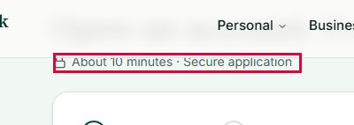
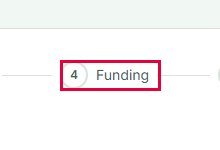
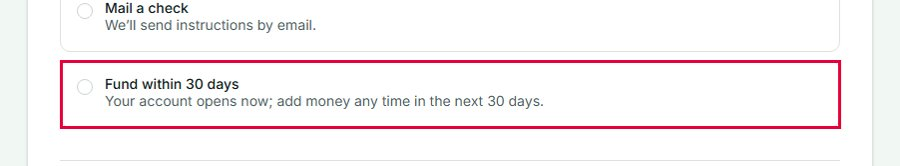

# F1: The application doesn't say up front that funding can wait, so a switcher without her old bank's details may stop before she finds out

**Severity:** medium · **Category:** ux · **Page:** `/open?product=everyday-checking` · **Confidence:** high

**Seen by simulated personas:** checking-switcher (hit in 2 of 2 walks that reached the page)

## What happens

Step 1 shows only 'About 10 minutes - Secure application' and a five-step bar ending in Funding; nothing lists what to have ready or says funding can be done later. The Funding step does solve the problem: 'Fund within 30 days - Your account opens now; add money any time in the next 30 days' sits beside bank transfer and mailed check, and the re-walk (checking-switcher-3) chose it, finished all five steps and reached Submit without a routing number. So the first walk's fear was unfounded, but the site gave no way to know that early: in walk 1 Dana stopped at the Address step and saved for later because she expected Funding to demand her old bank's routing number; in walk 3 she pressed on only on hope ('funding is step 4 - hopefully skippable') and afterwards asked for a warning that the routing number is optional. Switchers, the audience for 'no overdraft fees', are the people least likely to have funding details at hand.

## Evidence

- session `checking-switcher`, step 5, box [217, 72, 280, 22] — "About 10 minutes"

  
- session `checking-switcher`, step 23, box [723, 248, 100, 30]

  
- session `checking-switcher-3`, step 36, box [249, 694, 782, 68]

  

## Suggested fix

On step 1, under 'About 10 minutes', add one line: 'You'll need ID and your SSN or ITIN. You can fund now or within 30 days, so no other bank details are needed to apply.' Show the 30-day option as a hint under Funding in the progress bar.

_From a simulated persona study (alderwick-2026-11, Alderwick Bank (fictional demo bank website)). It shows where to look, not how many real customers are affected._
