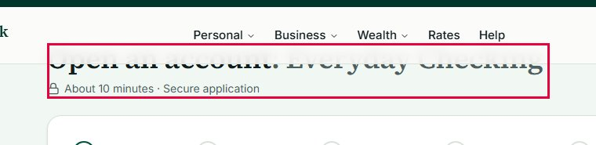
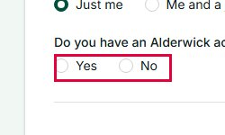

# F10: The application page opens partway down and then jumps to the top, so the first tap misses

**Severity:** low · **Category:** ui · **Page:** `/open?product=everyday-checking` · **Confidence:** low

**Seen by simulated personas:** checking-switcher (hit in 2 of 2 walks that reached the page)

## What happens

In both checking walks, arriving from the comparison table's 'Open an account' showed the application already scrolled, with the heading half under the site header; the first tap on 'No' landed on the moving layout and missed, and the page then sat at the top. Each walk lost one tap and reported that the page jumped. It happened the same way twice, but a screenshot taken mid smooth-scroll would look identical, so part of it may be capture timing.

## Evidence

- session `checking-switcher-3`, step 5, box [216, 55, 640, 70]

  
- session `checking-switcher`, step 6, box [249, 685, 130, 30]

  

## Suggested fix

Reset scroll to the top instantly (not smoothly) on route change, so /open first paints at the top.

_From a simulated persona study (alderwick-2026-11, Alderwick Bank (fictional demo bank website)). It shows where to look, not how many real customers are affected._
