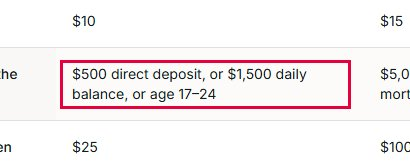
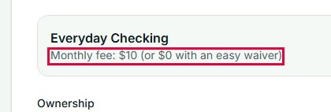
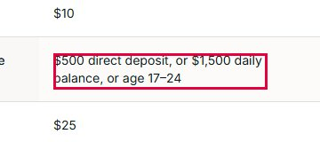

# F2: The checking comparison table leaves out conditions and fees the product page states

**Severity:** medium · **Category:** copy · **Page:** `/compare/checking` · **Confidence:** high

**Seen by simulated personas:** checking-switcher (hit in 2 of 2 walks that reached the page)

## What happens

Both walks of Dana chose Everyday Checking from the comparison table alone and both asked whether the '$500 direct deposit' waiver is monthly; the table never says. The Everyday detail page (seen in recon, not by either walk) says 'each statement cycle' and lists a $3/month paper-statement fee that the table omits, so she twice left believing the waivable $10 fee was the only charge. The application's product card then summarises the waiver as 'or $0 with an easy waiver', which both walks called vague. People who decide from the table, which the home page sends them to, get a lossy version of the terms.

## Evidence

- session `checking-switcher`, step 4, box [205, 222, 290, 48] — "$500 direct deposit"

  
- session `checking-switcher`, step 5, box [262, 400, 300, 22] — "or $0 with an easy waiver"

  
- session `checking-switcher-3`, step 4, box [217, 228, 240, 40] — "$500 direct deposit, or $1,500 daily balance"

  

## Suggested fix

Write the waiver row as '$500+ in direct deposits per statement cycle, or $1,500 daily balance, or age 17-24', add an 'Other fees' row (paper statements $3/month, $0 for e-statements or 65+), and replace 'easy waiver' on the application card with the actual waiver conditions.

_From a simulated persona study (alderwick-2026-11, Alderwick Bank (fictional demo bank website)). It shows where to look, not how many real customers are affected._
