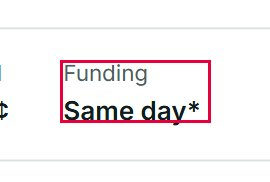
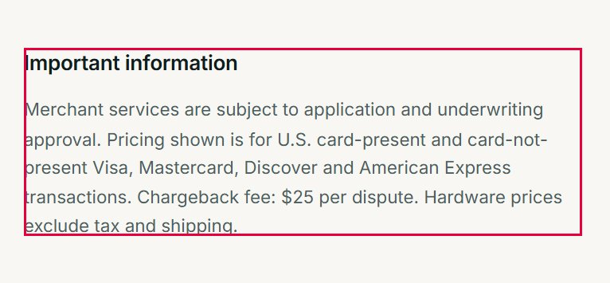

# F3: Merchant overview shows 'Same day*' and '$0' monthly with the conditions left off the page

**Severity:** high · **Category:** trust · **Page:** `/business/merchant-services` · **Confidence:** high

**Seen by simulated personas:** cafe-owner-merchant (hit in 2 of 2 walks that reached the page)

## What happens

Both merchant walks got their per-transaction prices from the Card Processing card on the overview (2.65% + 10c in person, 3.40% + 15c online, Monthly fee $0), which genuinely answers the question with no form. In both, the asterisk on 'Same day*' stayed unexplained: the page has no footnote for it, and its Important information covers only underwriting, card brands, the $25 chargeback and hardware tax. Both inferred the condition from the intro line and both left unsure whether they must open Alderwick business checking ('I think I can get next-day without banking here, but not sure'). The 9 p.m. ET cutoff and the $19.95/month PCI non-compliance fee are stated only on the Card Processing detail page (recon), which neither walk opened, so both concluded the monthly cost is $0 beyond the percentages while asking what a month would actually total; the second walk also found terminal prices ($349+) only in a separate card.

## Evidence

- session `cafe-owner-merchant`, step 5, box [285, 1262, 150, 62] — "Same day*"

  
- session `cafe-owner-merchant`, step 7, box [30, 605, 700, 235] — "Chargeback fee: $25 per dispute."

  
- session `cafe-owner-merchant-2`, step 5, box [285, 1262, 150, 62] — "Same day*"

  

## Suggested fix

Put the asterisk's footnote under the card ('*Into Alderwick business checking for batches closed by 9 p.m. ET; next business day to any other bank - no Alderwick account required'), show the PCI non-compliance fee next to 'Monthly fee $0' ('$0; $19.95/mo only if PCI not validated'), and add a worked example ('$15,000 a month in person = about $X, plus a terminal from $349 if you need one').

_From a simulated persona study (alderwick-2026-11, Alderwick Bank (fictional demo bank website)). It shows where to look, not how many real customers are affected._
