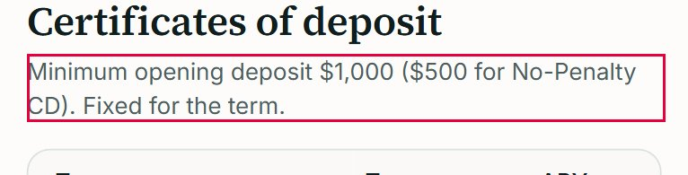
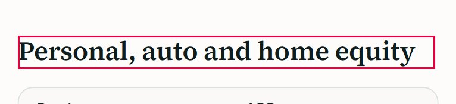

# F4: The CD early-withdrawal penalty sits at the bottom of the rates page, past mortgages, loans and cards

**Severity:** medium · **Category:** friction · **Page:** `/rates` · **Confidence:** high

**Seen by simulated personas:** cd-rate-checker-phone (hit in 1 of 1 walks that reached the page)

## What happens

Marcus found the 12-month rate (4.15%) and the $1,000 minimum within five taps, but the CD section's intro only says 'Fixed for the term'. The penalty (90 days of interest for terms of 12 months or less) is in the Important information at the foot of the page, below mortgages, personal loans and credit cards. On a phone one scroll took him past the CD table into mortgages, and he left without the penalty, one of the three things he needed before acting.

## Evidence

- session `cd-rate-checker-phone`, step 5, box [30, 728, 710, 75] — "Fixed for the term."

  
- session `cd-rate-checker-phone`, step 6, box [30, 585, 700, 55]

  

## Suggested fix

Add the penalty to the CD intro line ('Fixed for the term. Early withdrawal: 90 days of interest for 12 months or less, 180 days for longer terms.') and link to /personal/cds.

_From a simulated persona study (alderwick-2026-11, Alderwick Bank (fictional demo bank website)). It shows where to look, not how many real customers are affected._
