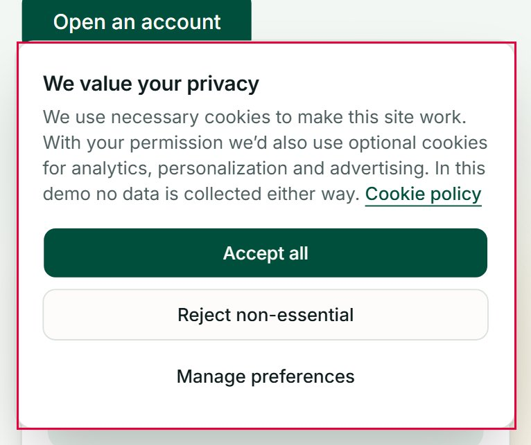
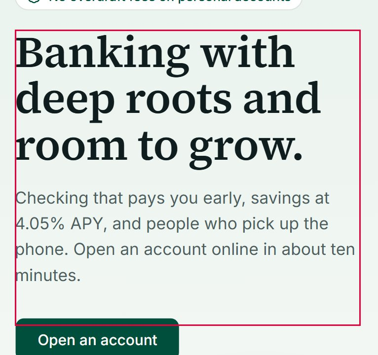
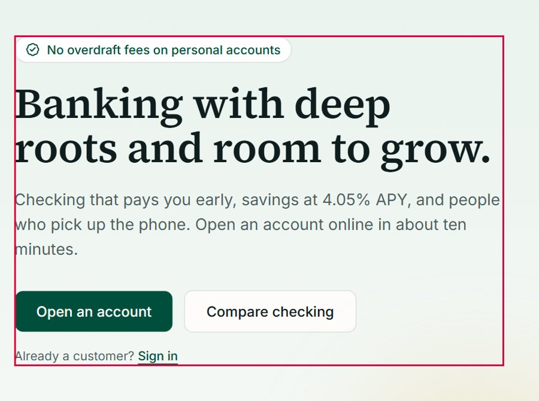

# F5: The home page speaks only to personal checking; business, wealth and rate seekers must find the menu

**Severity:** medium · **Category:** ux · **Page:** `/` · **Confidence:** medium

**Seen by simulated personas:** cafe-owner-merchant, cd-rate-checker-phone, retiree-wealth-callback (hit in 4 of 6 walks that reached the page)

## What happens

Three of the four personas (four of the six walks) came for something other than checking (card processing, a CD rate, private banking) and each reported the first screen had nothing for them: the badge, hero and buttons are all personal checking. On a phone the hero fills the first screen and the cookie box covers about a third of it on arrival. All recovered by opening the hamburger menu, so the cost was a moment of doubt ('Does this bank even have a private banking team?') rather than lost visits in this run. Dana, who wanted checking, went straight to 'Compare checking' and was unaffected.

## Evidence

- session `cafe-owner-merchant`, step 1, box [24, 978, 720, 560] — "We value your privacy"

  
- session `cd-rate-checker-phone`, step 2, box [30, 320, 700, 600]

  
- session `retiree-wealth-callback`, step 2, box [24, 180, 830, 560]

  

## Suggested fix

Add a row of entry points directly under the hero (Business banking and merchant services; Today's rates including the 12-month CD; Private banking, talk to a relationship manager), visible on the first phone screen once the cookie box is dismissed.

_From a simulated persona study (alderwick-2026-11, Alderwick Bank (fictional demo bank website)). It shows where to look, not how many real customers are affected._
