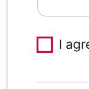

# F6: The required consent checkbox on the wealth form has a near-invisible border

**Severity:** medium · **Category:** contrast · **Page:** `/wealth/contact` · **Confidence:** high

**Seen by simulated personas:** retiree-wealth-callback (hit in 1 of 1 walks that reached the page)

## What happens

The 'I agree to be contacted' box, which must be ticked to send the request, has a pale grey border measured at 1.52:1 against white and is about 17 CSS px square. Eleanor (reading glasses, browsing at 150%) called it small and pale compared with everything else and wasn't sure the label was clickable too. She managed it, but a low-vision user can miss a required control and then hit an error on submit.

## Measured

Measurement `retiree-wealth-callback:M1`, target `ui_component`.

## Evidence

- session `retiree-wealth-callback`, step 29, box [137, 481, 26, 26]

  

## Suggested fix

Give unchecked checkboxes and radios a border of at least 3:1 (for example the body grey #5c6c6c), enlarge the box to 24 px, and make the whole label a visible click target.

_From a simulated persona study (alderwick-2026-11, Alderwick Bank (fictional demo bank website)). It shows where to look, not how many real customers are affected._
