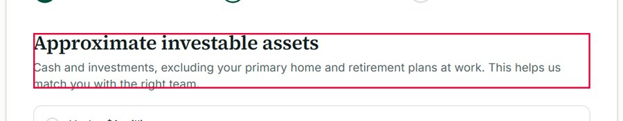

# F7: Nothing on the wealth path says who qualifies for private banking

**Severity:** low · **Category:** copy · **Page:** `/wealth/contact` · **Confidence:** medium

**Seen by simulated personas:** retiree-wealth-callback (hit in 1 of 1 walks that reached the page)

## What happens

Eleanor, with about $2 million to move, asked repeatedly whether that was enough. The form asks for an asset band ('This helps us match you with the right team') but no screen she saw states a minimum or what happens below it. She completed the form anyway; the doubt lowered her confidence rather than stopping her.

## Evidence

- session `retiree-wealth-callback`, step 11, box [138, 300, 1004, 100] — "This helps us match you with the right team."

  

## Suggested fix

State the private banking threshold, or 'There's no minimum to talk to us', beside the asset question and on the Wealth menu promo.

_From a simulated persona study (alderwick-2026-11, Alderwick Bank (fictional demo bank website)). It shows where to look, not how many real customers are affected._
