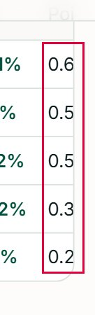
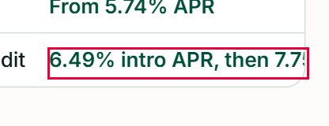

# F8: Rate tables on a phone are cut off at the right edge with no sign they scroll

**Severity:** low · **Category:** ui · **Page:** `/rates` · **Confidence:** medium

**Seen by simulated personas:** cd-rate-checker-phone (hit in 1 of 1 walks that reached the page)

## What happens

At 412 px wide the mortgage table's points column, the HELOC rate ('then 7.7...') and the credit card APRs ('variab...') are clipped at the right edge with no visible scroll cue. Marcus's CD table fit, so it didn't affect his task, but anyone on a phone comparing loans or cards would read partial figures.

## Evidence

- session `cd-rate-checker-phone`, step 6, box [690, 150, 60, 330]

  
- session `cd-rate-checker-phone`, step 6, box [410, 1040, 330, 40]

  

## Suggested fix

Stack those tables into cards below 600 px, or add a visible scroll shadow or label and keep the APR column in view.

_From a simulated persona study (alderwick-2026-11, Alderwick Bank (fictional demo bank website)). It shows where to look, not how many real customers are affected._
