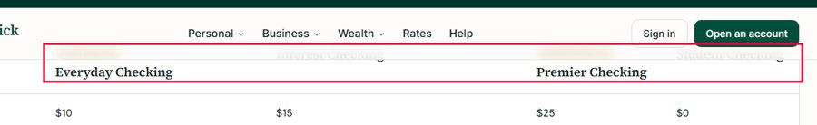

# F9: The site header hides the comparison table's column names while scrolling

**Severity:** low · **Category:** ui · **Page:** `/compare/checking` · **Confidence:** high

**Seen by simulated personas:** checking-switcher (hit in 2 of 2 walks that reached the page)

## What happens

When the comparison table is scrolled, its sticky column headings slide under the site's sticky header, so 'Interest Checking' and 'Student Checking' are half covered. Dana noticed and relied on column alignment to tell which 'Open an account' button was Everyday's. Only the first walk remarked on it; the re-walk scrolled the same table without comment.

## Evidence

- session `checking-switcher`, step 4, box [200, 85, 1060, 55]

  

## Suggested fix

Offset the table's sticky header by the site header's height (about 108 px on desktop) so column names stay fully visible.

_From a simulated persona study (alderwick-2026-11, Alderwick Bank (fictional demo bank website)). It shows where to look, not how many real customers are affected._
